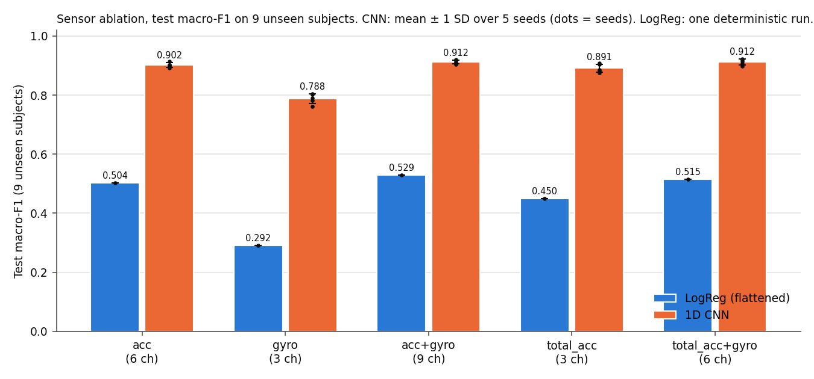
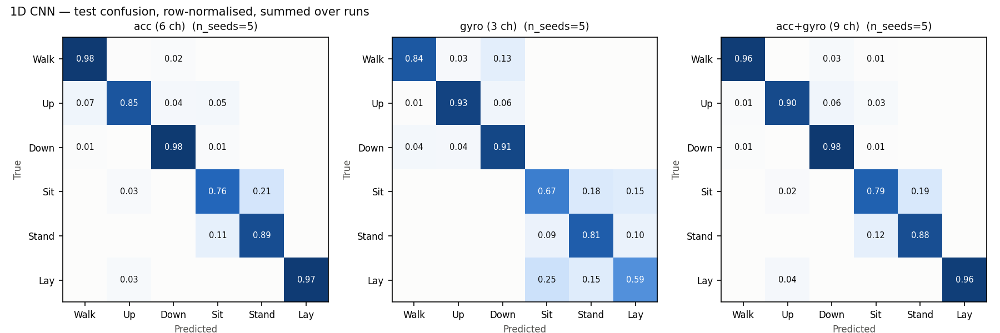
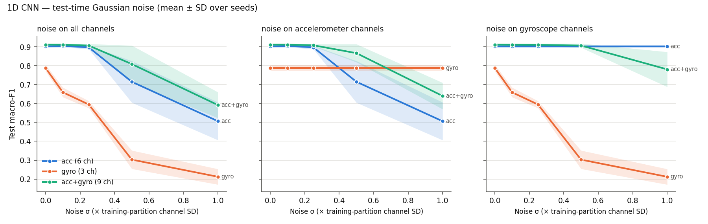

# MotionSense Lab: Accelerometer–Gyroscope Fusion for Activity Recognition on Unseen Subjects

A controlled sensor-ablation study on the UCI HAR smartphone dataset: raw
inertial windows (128 samples × 9 channels at 50 Hz), a flattened-window
logistic-regression baseline, and a ~25k-parameter 1D CNN, evaluated on
held-out subjects with CPU latency measurements. The full write-up, including
every number below with its source file, is in
**[RESEARCH_REPORT.md](RESEARCH_REPORT.md)**.

## Motivation

Wearable and phone-based activity recognition usually carries both an
accelerometer and a gyroscope, but each extra sensor costs power, bandwidth
and model inputs. Before paying that cost, it is worth knowing how much the
gyroscope adds *for people the model has never seen*: that is the deployment
case, and it is where subject-to-subject variation can hide small effects.
This project measures that, keeping the model, training budget and
evaluation protocol fixed and changing only which sensor channels go in.

## Research question and hypotheses

> Does combining accelerometer and gyroscope signals improve activity
> recognition for unseen subjects while maintaining efficient inference?

* **H1 (accuracy).** With the same model and training budget, acc + gyro
  gives higher test macro-F1 on unseen subjects than either sensor alone.
* **H2 (efficiency).** Fusion adds little CPU inference cost, and inference
  time is small relative to the 2.56 s observation window.

The primary metric is macro-F1, which weights the hard static postures
(sitting vs standing) equally with the easy classes. Accuracy is also
reported.

## Summary of findings

* **vs gyroscope only:** fusion is much better (+0.124 macro-F1; better on
  5/5 seeds and 8/9 test subjects). This narrowly misses significance at the
  subject level after Holm correction (p = 0.059).
* **vs accelerometer only:** fusion is slightly better on average (+0.010;
  +0.013 on a second validation split), but the subject-level test is not
  significant (Wilcoxon p = 0.20, Holm 0.26). One subject accounts for most of
  the gain. **H1 is not established against the accelerometer.**
* **Cost:** fusion adds 672 parameters (+2.7 %) and no latency difference
  measurable with this setup.
  Model inference is ≈0.5 ms median per window on one CPU thread for every
  CNN variant (p95 0.77–0.88 ms).
* **Robustness:** under heavy noise on the gyroscope alone, the fused model
  falls *below* the clean accelerometer-only model (0.781 vs 0.902).

**About the latency number.** ≈0.5 ms is **model-only CPU inference**: the
forward pass on one window that has already been recorded and standardised.
It is not end-to-end recognition latency. Each window holds 2.56 s of
signal, and with the dataset's 50 % overlap a new window completes every
1.28 s. After an activity changes, the first window made up entirely of the
new activity therefore completes 2.56–3.84 s later, although the classifier
may react earlier to partially filled windows. Recognition delay is thus set
by the windowing scheme, and the ~0.5 ms model time is negligible next to it.
Sensor I/O, buffering and app scheduling were not measured.

**Scope.** This is inertial-sensor research: a body-worn smartphone's
accelerometer and gyroscope. It involves no cameras, video or pose
estimation, and its numbers should not be read as evidence about
camera-based motion tracking.

## Architecture overview

```text
UCI archive ──► SHA-256 check ──► nested-ZIP extraction (whitelisted files)
            ──► raw windows (n, 9, 128) ──► channel subset for the condition
            ──► subject-level train/val split ──► per-channel standardisation
                (fit on training subjects only)
            ──► model ──► validation-only selection ──► single test evaluation
            ──► CPU latency benchmark (separate stage) ──► noise robustness
            ──► paired, subject-level statistics ──► figures, CSV/JSON
```

| model | input | structure | params |
|---|---|---|---|
| Logistic regression (scikit-learn, lbfgs, L2) | standardised window flattened to 128·C features | linear; `C` chosen on validation | 2,310–6,918 |
| 1D CNN (PyTorch) | standardised window, C × 128 | 3 × [Conv1d → BatchNorm → ReLU] (32/64/64 filters, kernels 7/5/3, max-pool after blocks 1–2) → global avg pool → dropout 0.3 → linear | 23,910–25,254 |

The logistic regression gives each (channel, timestep) its own fixed weight.
It can exploit class differences in mean signal level, such as gravity
orientation, and waveform patterns that recur at the same position in the
window. But it has no mechanism to pool over the phase at which a gait cycle
starts, and as a linear score it cannot compute nonlinear summaries such as
signal energy or dominant frequency. It is a deliberate lower bound, not a
competitive classical baseline. A feature-based classical model was not run. In the CNN, only the first
layer depends on the number of input channels, so sensor conditions differ in
their input and nothing else.

Code layout:

```text
src/motionsense/   data.py (download, extraction, splits) · preprocess.py · models.py
                   train.py · experiment.py (ablation grid) · benchmark.py · noise.py
                   robustness.py · analysis.py (statistics) · plots.py
configs/           default.yaml (main study) · smoke.yaml (pipeline check only)
                   supplementary/ (post-hoc sensitivity runs)
scripts/           audit_results.py · verify_report_claims.py
tests/             protocol / leakage unit tests and an end-to-end smoke test
results/           measured outputs: CSV/JSON tables, per-run records, figures
```

## Dataset

[UCI Human Activity Recognition Using Smartphones](https://archive.ics.uci.edu/dataset/240/human+activity+recognition+using+smartphones):

* 30 volunteers aged 19–48 with a Samsung Galaxy S II on the waist, six
  activities (walking, upstairs, downstairs, sitting, standing, laying).
* Official subject-disjoint split: 7,352 training windows from 21 subjects,
  2,947 test windows from 9 subjects.
* The raw *Inertial Signals* are used, not the precomputed 561-feature
  vectors.

Channels: `total_acc` (accelerometer, g), `body_acc`, and `body_gyro`
(gyroscope, rad/s). Per the dataset description, `body_acc` is `total_acc`
minus a 0.3 Hz Butterworth low-pass gravity estimate. It is *derived* from the
accelerometer, not a separate sensor, so "accelerometer only" has 6 channels
and "gyroscope only" has 3. Two controls with matched channel counts separate
the sensor from the channel count:

| condition | channels | count |
|---|---|---|
| `acc` | total_acc + body_acc | 6 |
| `gyro` | body_gyro | 3 |
| `acc_gyro` | all | 9 |
| `acc_raw3` (control) | total_acc | 3 |
| `acc_raw3_gyro` (control) | total_acc + body_gyro | 6 |

The data is downloaded from UCI at run time and is **not redistributed** in
this repository. The dataset authors require citing: D. Anguita, A. Ghio,
L. Oneto, X. Parra and J. L. Reyes-Ortiz, *A Public Domain Dataset for Human
Activity Recognition Using Smartphones*, ESANN 2013. Their license text also
states that commercial use is prohibited.

## Experimental methodology

* **Subject-disjoint evaluation.** The official 21/9 split is kept. Validation
  is 5 whole subjects drawn from the 21 training subjects: {8, 11, 16, 19, 23}.
  Windows overlap 50 % within a recording, so a window-level split would leak.
* **No preprocessing leakage.** Per-channel mean/SD are fitted on the 16
  training subjects only and applied to validation and test.
* **No test-set selection.** LogReg `C` ∈ {0.001, 0.01, 0.1, 1} and the CNN
  early-stopping epoch (patience 10 on validation macro-F1, at most 60 epochs)
  are chosen on validation. The test set is evaluated once per final model.
* **Equal budget.** All hyperparameters were fixed before the main run and
  are identical across sensor conditions (AdamW, lr 1e-3, weight decay 1e-4,
  batch 64).
* **Seeds and determinism.** CNN: 5 seeds per condition, deterministic
  PyTorch algorithms. A retrain reproduced the test macro-F1 bit-for-bit.
  LogReg is deterministic, so it is run once per condition.
* **Latency.** A separate stage after training: batch size 1, 100 warm-up
  calls, then 3 shuffled rounds of 500 timed calls; median and p95 reported;
  torch and BLAS threads limited to 1 (4 threads also measured).
* **Statistics.** The unit of analysis is the test subject (n = 9), not the
  window. For each comparison: paired seed differences, per-subject
  differences with a two-sided exact Wilcoxon signed-rank test, a bootstrap
  95 % CI, and Holm correction within each model family.
* **Robustness (additional).** Gaussian noise at σ ∈ {0.1, 0.25, 0.5, 1.0} ×
  the training-partition channel SD, added to test windows only (all channels,
  accelerometer channels only, or gyro channels only). No retraining.

## Results

Test set: 9 unseen subjects. CNN values are mean ± SD over 5 seeds; LogReg is
one deterministic run. Latency is CNN model-only inference, 1 thread.

| condition | ch | LogReg macro-F1 | CNN accuracy | CNN macro-F1 | CNN params | CNN latency median / p95 (ms) |
|---|---|---|---|---|---|---|
| acc | 6 | 0.504 | 0.902 ± 0.007 | **0.902 ± 0.008** | 24,582 | 0.454 / 0.768 |
| gyro | 3 | 0.292 | 0.784 ± 0.017 | **0.788 ± 0.017** | 23,910 | 0.514 / 0.849 |
| acc + gyro | 9 | 0.529 | 0.911 ± 0.006 | **0.912 ± 0.006** | 25,254 | 0.504 / 0.832 |
| total_acc (control) | 3 | 0.450 | 0.891 ± 0.014 | **0.891 ± 0.014** | 23,910 | 0.506 / 0.805 |
| total_acc + gyro (control) | 6 | 0.515 | 0.913 ± 0.009 | **0.912 ± 0.010** | 24,582 | 0.512 / 0.882 |

Source: [results/summary.csv](results/summary.csv) (per-run rows in
[results/runs.csv](results/runs.csv)). The latency differences between
conditions are smaller than the run-to-run spread of identical architectures
(0.40–0.62 ms medians), so they should be read as "no measurable difference".

<p align="center"></p>

<p align="center"></p>

The gyroscope-only model largely fails to separate laying from sitting and
standing (laying recall 0.59). A gyroscope measures rotation rate, so a
stationary posture gives it no direct gravity-orientation cue. Every accelerometer model's main
error is sitting ↔ standing.

<p align="center"></p>

With noise on the gyroscope only (right panel), the fused model degrades from
0.912 to 0.781 at σ = 1, below the clean accelerometer-only model (0.902).

## Statistical interpretation

Paired comparisons for the CNN. Δ is the macro-F1 difference (first minus
second). From [results/comparisons.json](results/comparisons.json).

| comparison | Δ over seeds | seeds better | subjects better | 95 % bootstrap CI (subject Δ) | Wilcoxon p | Holm p |
|---|---|---|---|---|---|---|
| acc+gyro vs acc | +0.0095 | 4/5 | 6/9 (1 tie) | [−0.0058, +0.0407] | 0.195 | 0.258 |
| acc+gyro vs gyro | +0.1241 | 5/5 | 8/9 | [+0.0624, +0.1644] | 0.012 | 0.059 |
| total_acc+gyro vs total_acc | +0.0214 | 4/5 | 7/9 | [+0.0038, +0.0594] | 0.074 | 0.223 |
| total_acc vs gyro | +0.1031 | 5/5 | 7/9 | [+0.0378, +0.1403] | 0.020 | 0.078 |

* With 9 test subjects, the smallest possible two-sided Wilcoxon p is
  0.0039. No CNN comparison is significant at 0.05 after Holm correction,
  including the large fusion-vs-gyro gap. This reflects the test's limited
  power at n = 9, not evidence of no effect.
* The fusion-vs-accelerometer gain (+0.010) is about the same size as the
  seed SD of either model (0.006–0.008), and its subject-level CI includes 0.
  A second validation split gave +0.013 (Holm p = 0.29), the same picture.
* Where the gyroscope helps: mainly the dynamic classes (walking, upstairs)
  and mostly in one subject, S9, whose upstairs windows the accelerometer-only
  model calls "walking".

## Failure analysis

* **Sitting ↔ standing** dominates: 21 % (acc) and 19 % (acc+gyro) of sitting
  windows are predicted as standing. With a waist-mounted phone, the two
  postures differ only by a small trunk tilt.
* **Errors concentrate in a few subjects.** acc+gyro macro-F1 is ≥ 0.866 for
  7 of 9 test subjects but 0.742 for S9 and 0.591 for S10.
  * In S10, 108 of 290 laying windows (summed over 5 seeds) are predicted as
    walking upstairs. That is physically implausible and suggests an unusual
    device orientation for that subject.
  * In S2, 166 of 230 sitting windows are predicted as standing.
* **Validation is a weak selection signal.** Validation macro-F1 is about
  0.91 for every accelerometer-containing condition, and early stopping chose
  epoch 1–3 in 4 of 25 CNN runs.

## Limitations

* **Nine test subjects** limit every comparative claim. Per-subject macro-F1
  ranges from 0.59 to 1.00, which dwarfs the fusion effect.
* **One dataset:** one device, one placement (waist), and a lab protocol.
  Nothing here is shown for other placements, populations or free-living
  data.
* **Offline filters:** `body_acc` and the authors' noise filtering were
  computed offline, and the dataset documentation does not say whether they
  are causal. The `total_acc` controls avoid this and perform about the same.
* **No per-condition CNN hyperparameter search** (equal fixed budget instead),
  and a weak linear baseline. A feature-based classical baseline was not run.
* **Latency hardware:** measured on one x86 laptop CPU in PyTorch eager mode.
  No phone/ARM measurement, no quantisation.
* **Synthetic noise:** i.i.d. Gaussian, drawn independently even for
  channels derived from the same sensor.
* **Post-hoc analyses:** the two supplementary analyses (an extended LogReg
  `C` grid and a second validation split) and the Holm correction were added
  after the main results were seen. They are reported separately; no
  main-table number was changed. See RESEARCH_REPORT.md §6 and §8.

## Reproducing the study

Tested on Windows 11 with Python 3.13.7, CPU only. Other platforms have not
been tested.

**1. Environment** (Windows PowerShell; on macOS/Linux use
`python3.13 -m venv .venv` and `.venv/bin/python`).

```powershell
py -3.13 -m venv .venv
.venv\Scripts\python -m pip install -r requirements.txt --index-url https://download.pytorch.org/whl/cpu --extra-index-url https://pypi.org/simple
.venv\Scripts\python -m pip install -e . --no-deps
```

`requirements.txt` pins the direct dependencies. The index flags select the
CPU build of PyTorch 2.12.0. `requirements-lock.txt` lists the exact version
of every package in the dependency closure that produced `results/`.

**2. Tests**: protocol and leakage unit tests, plus an end-to-end smoke run
once the data is present.

```powershell
.venv\Scripts\python -m pytest -q
```

**3. Main experiment**: download → train → benchmark → robustness → analysis
→ figures. About 14 minutes on the study machine (8 training threads).

```powershell
.venv\Scripts\python -m motionsense all --config configs/default.yaml
```

Each stage can also be run alone: `download`, `train`, `benchmark`,
`robustness`, `analyze`, `figures`.

**4. Verification**

```powershell
# Re-derive every metric from saved artifacts; check subject disjointness and
# train-only scalers; retrain one run and require identical results.
.venv\Scripts\python scripts\audit_results.py --config configs/default.yaml --retrain cnn_acc_gyro_s1
# Check that the numbers quoted in README.md / RESEARCH_REPORT.md match results/.
.venv\Scripts\python scripts\verify_report_claims.py
```

**5. Post-hoc sensitivity runs** (RESEARCH_REPORT.md §6)

```powershell
.venv\Scripts\python -m motionsense train   --config configs/supplementary/logreg_extended_C.yaml
.venv\Scripts\python -m motionsense analyze --config configs/supplementary/logreg_extended_C.yaml
.venv\Scripts\python -m motionsense train   --config configs/supplementary/val_split_seed1.yaml
.venv\Scripts\python -m motionsense analyze --config configs/supplementary/val_split_seed1.yaml
```

Latency numbers depend on hardware and background load. Accuracy numbers
should reproduce exactly with the same library versions and thread settings;
this was checked only on the study machine.

**Windows application-control note (machine-specific).** On the study
machine, Windows Application Control blocked a freshly installed native wheel
(scikit-learn 1.9.1): `DLL load failed ... An Application Control policy has
blocked this file`. The policy was not bypassed. The results were produced
with already-installed copies of the versions pinned in `requirements.txt`,
made visible to the project venv with `--system-site-packages`. That
workaround is specific to that machine and is not part of the standard
instructions above. If you hit the same error, do not disable the policy:
install the pinned versions in an environment your policy allows, or ask
your administrator.

## Outputs

| path | content |
|---|---|
| `results/summary.csv` / `.json` | mean ± SD over seeds per model × condition |
| `results/runs.csv` | one row per run (val/test metrics, params, latency, best epoch) |
| `results/comparisons.json` | paired comparisons, bootstrap CIs, Wilcoxon and Holm p-values |
| `results/robustness.csv` | macro-F1 under noise per run, noise target and σ |
| `results/subject_confusions.json` | per-test-subject confusion matrices |
| `results/runs/<run>/metrics.json` | split subjects, scaler statistics, per-class F1, confusion matrix, per-subject metrics, latency |
| `results/runs/<run>/history.csv` | CNN learning curves |
| `results/experiment_config.json`, `benchmark_environment.json` | resolved configuration, library versions, CPU |
| `results/audit_log.txt` | output of `audit_results.py` |
| `results/supplementary/` | post-hoc sensitivity runs |

Model checkpoints and the dataset are not committed; the commands above
regenerate them.

## License

Code: [MIT](LICENSE). The UCI HAR dataset is not included. It is downloaded
from UCI at run time and is subject to its authors' terms (see
[Dataset](#dataset)).
